# SDLC automation orchestrator

Deterministic Go orchestrator (Postgres-backed state machine) that drives Claude agents through
PRD -> ADD -> repo breakdown -> Jira -> workspace -> per-ticket dev -> testing -> MR -> post-MR,
with human gates, an ambiguity ledger, an audit trail and traceability.

## Run it

```
go build -o sdlc.exe ./cmd/sdlc

# Unattended end-to-end demo (auto-approver stands in for humans; clearly attributed in the audit trail)
sdlc demo -agent mock              # deterministic, free, ~20s: exercises state machine, loops, gates
sdlc demo -agent claude -budget 10 # real agents build the sample "document organizer" app

# Human-in-the-loop
sdlc up -agent claude              # terminal 1: embedded Postgres + workers + dashboard on :8080
sdlc start -title "Doc organizer" -idea "..."          # terminal 2
# then answer questions / approve gates in the dashboard, or:
sdlc status <run-id>
sdlc answer <question-id> -accept        # accept the proposed default as an explicit assumption
sdlc approve <gate-id>                   # or: -reject -comment "why"
sdlc trace <run-id>
sdlc ci-check <run-id> [ticket]          # exit 1 blocks merge
```

Postgres is embedded (zonky binaries, port 5433, data in `data/pg`), so no Docker is needed. Set
`SDLC_DB` to use your own Postgres instead.

## Screenshots

A full run captured from the dashboard, one screen per capability. **Provenance:** these were captured with
the deterministic `mock` agent (so spend shows $0.00 and the PRD text is short and canned) against the
fake Jira/Confluence/GitHub server (`cmd/fakeapi`) backed by real git repos. Humans are simulated by
driving the dashboard's own forms (`scripts/capture-screenshots.ps1`); the approver names in the audit trail
(`priya-pm`, `arjun-lead`, `sam-dev`, `mei-reviewer`) are placeholders. Everything on screen is the real
orchestrator, state machine, UI and integration code.

### 1. Start a run
Describe what to build; pick a change size (trivial changes skip PRD + design).

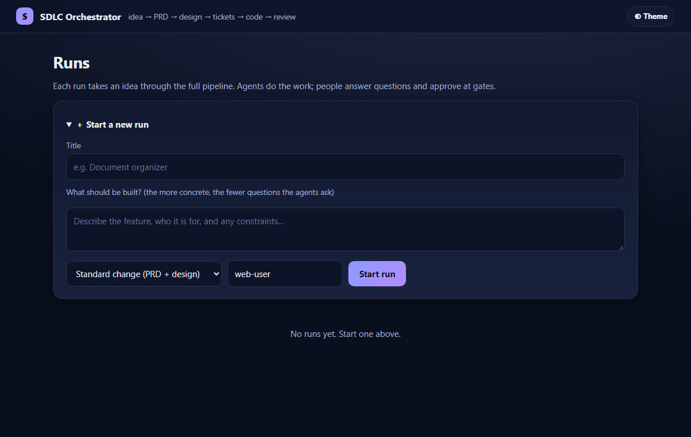

### 2. Ambiguity ledger: agents ask, you decide
Before each phase the agent raises prioritized questions with a proposed default. The phase will not proceed
until each is answered, or the default is explicitly accepted as an assumption (which is recorded and written into the document).

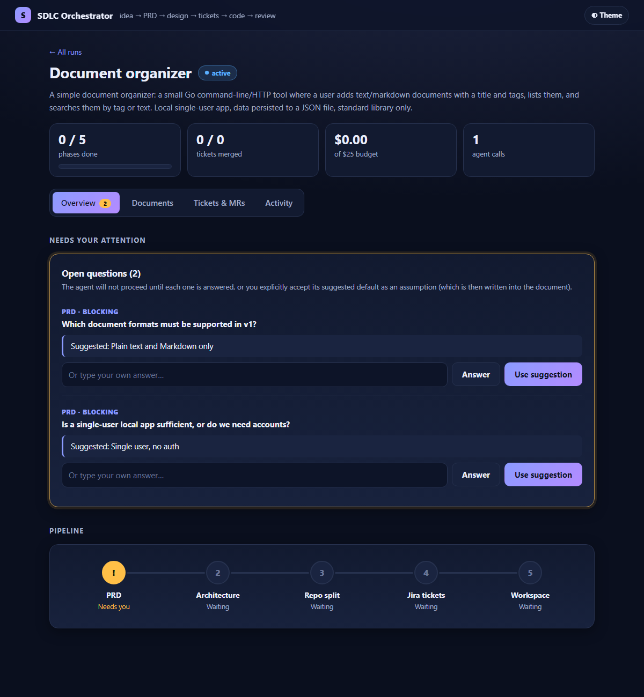

### 3. Approval gates, bound to the exact document version
Every gate shows the document under review (rendered), the critic agent's findings and how many revision
rounds it forced, and records who approved which content hash.

| PRD approval | Jira dry-run preview |
|---|---|
| 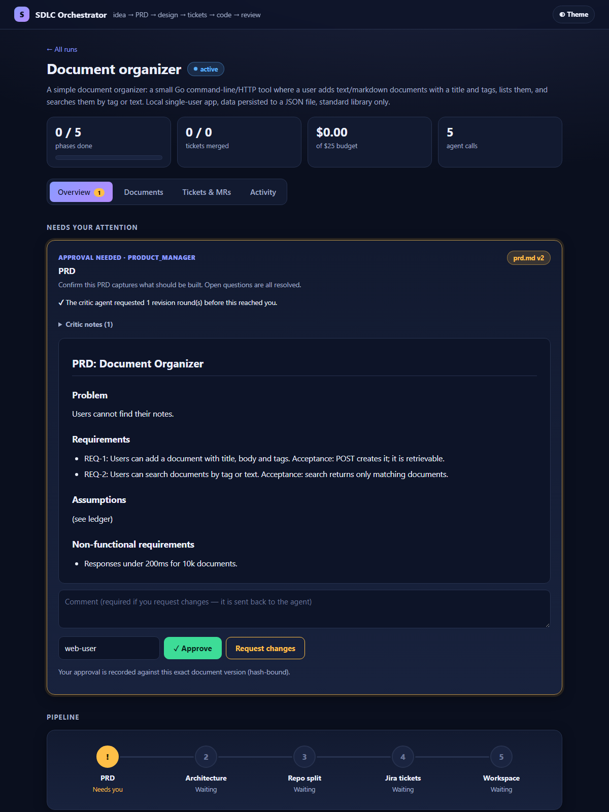 | 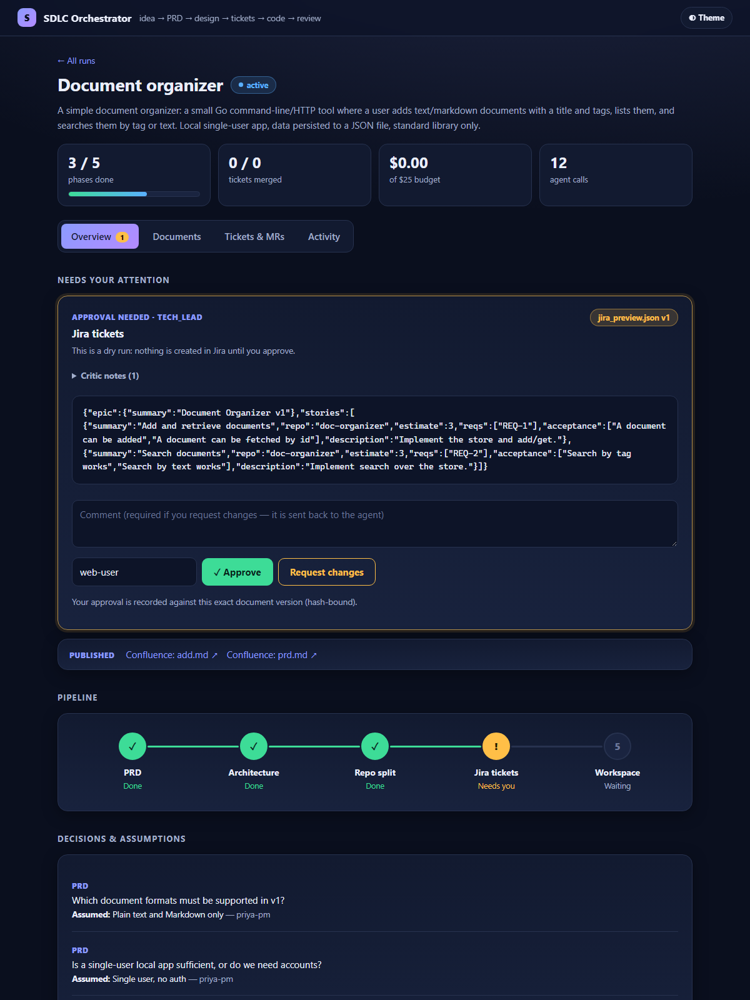 |

| Implementation plan (before any code) | Post-MR review and scan results |
|---|---|
| 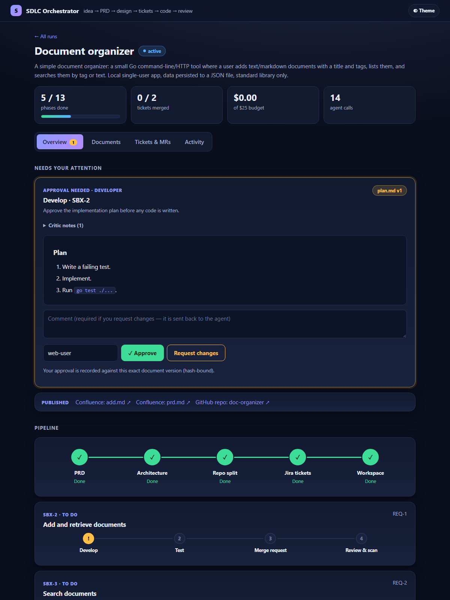 | 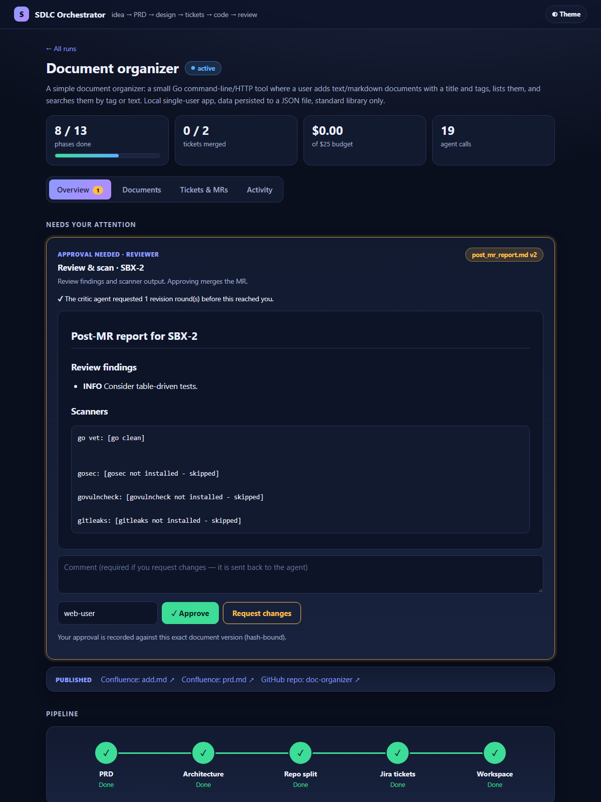 |

### 4. Real integrations: the pipeline waits for a human to merge the GitHub PR
Links to the published Confluence pages and GitHub repo appear on the run; after review approval the
pipeline polls the PR and continues by itself once it is merged.

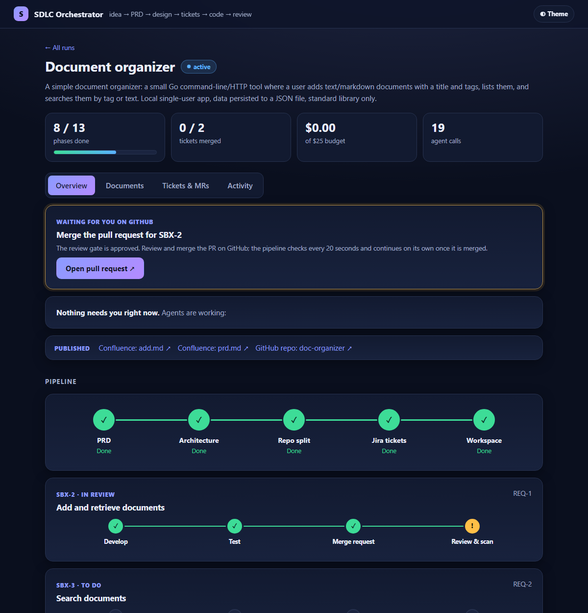

### 5. Run complete: pipeline, per-ticket progress, decisions and assumptions

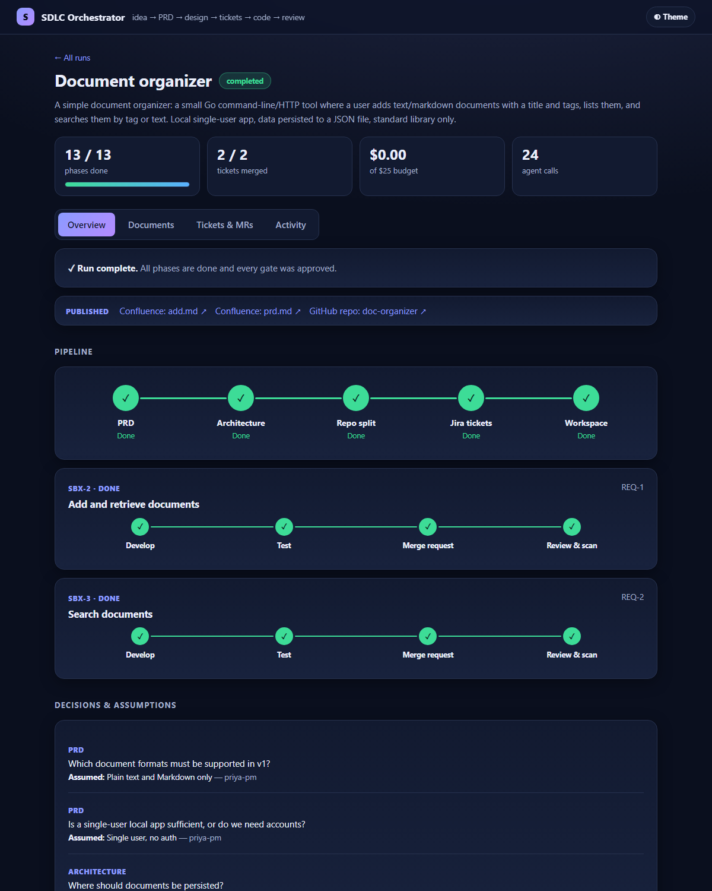

### 6. Documents (versioned, hashed), tickets and merge requests

| Documents | Tickets and MRs |
|---|---|
| 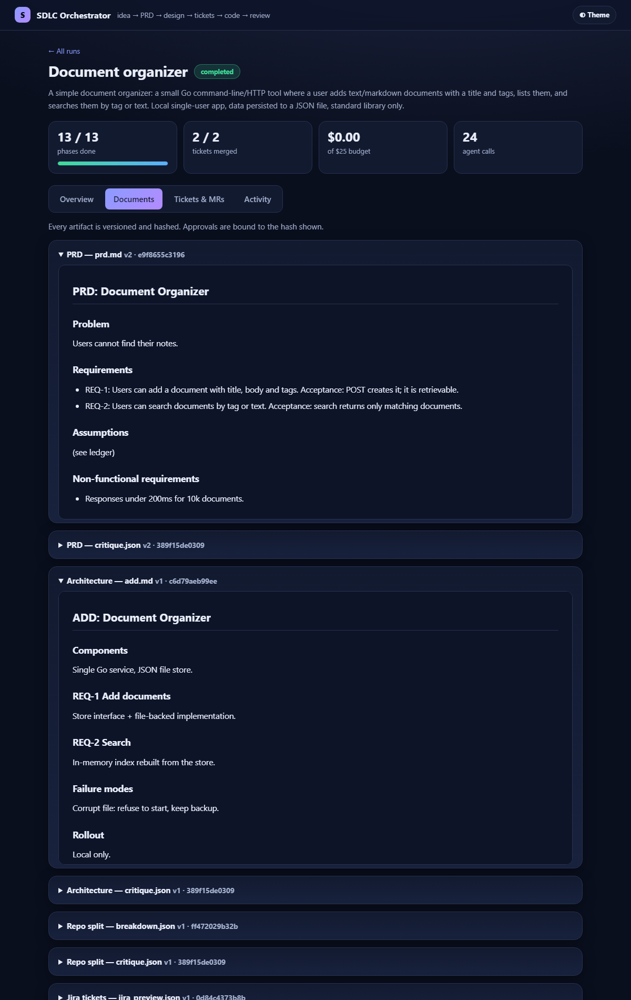 | 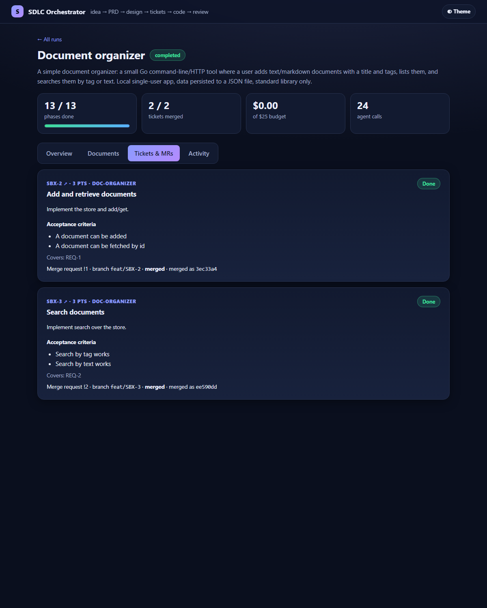 |

### 7. Audit trail, runs list and light theme

| Activity feed | Runs list |
|---|---|
| 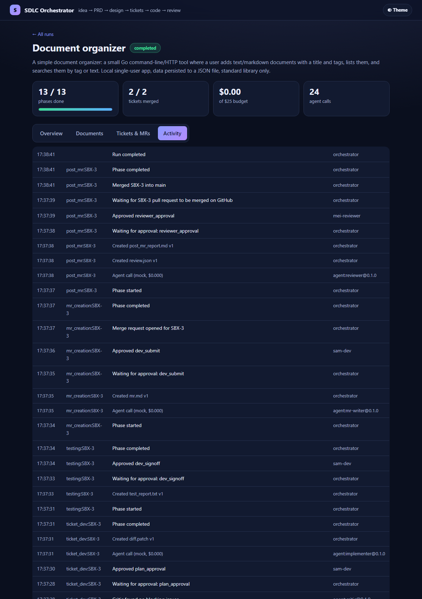 | 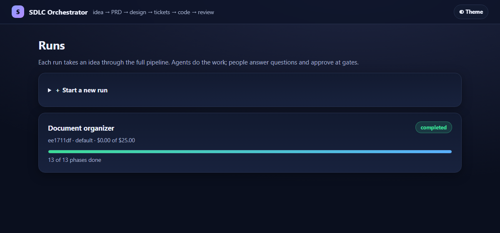 |

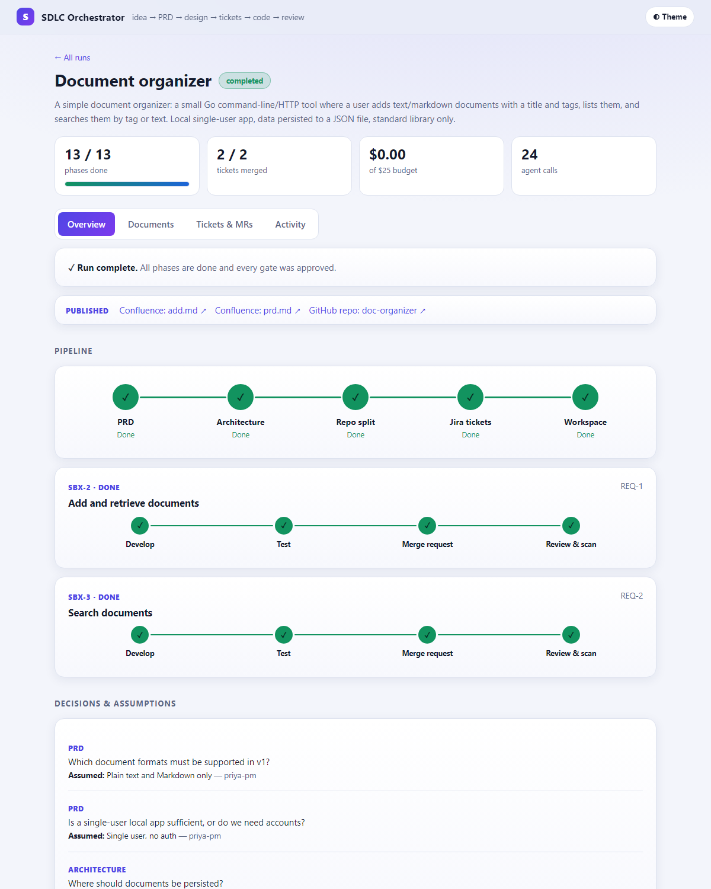

### CLI

`sdlc status`, `sdlc trace` (requirement to merge) and `sdlc ci-check` for the same run are in
[`docs/cli-output.txt`](docs/cli-output.txt).

To regenerate: start `fakeapi`, start `sdlc up -agent mock` (no auto-approve) and run
`pwsh scripts/capture-screenshots.ps1 -Base http://localhost:8090`.

## How it works

Every phase runs the same pipeline, implemented once in `internal/engine/worker.go`:

`clarify -> generate -> critique -> validate -> gate -> publish`

| step | who | what |
|---|---|---|
| clarify | agent | raises numbered questions, each with a proposed default, into the ledger. The phase waits until none are open; a human answers or explicitly accepts the default as an assumption (a DB trigger refuses to open a gate otherwise). |
| generate | agent/tools | writes an immutable, hashed, versioned artifact (lineage recorded in `artifact_input`). |
| critique | separate agent | adversarial review; blocking findings loop back to generate (bounded). |
| validate | deterministic code | schema/coverage checks (every REQ in the ADD, every REQ covered by a story, tests pass...). |
| gate | human | approval is bound to the exact artifact hash (DB trigger). Request-changes feeds the comment back into generate. |
| publish | orchestrator | side effects (Jira issues, worktrees, merge), events, phase complete. |

Phase definitions live in `internal/engine/phases.go` (`getDef`); `phases/prd.phase.yaml` documents the contract.

State: `migrations/*.sql` (runs, phases, artifacts, ledger, gates, approvals, job queue with
`SKIP LOCKED` leases, agent invocations + cost, trace links, events + transactional outbox).
Events are relayed to `data/events.jsonl` (swap `FlushOutbox` for a Kafka producer).

Agents: `internal/agent`. `claude` drives Claude Code headless (`claude -p`, JSON output, cost
recorded per call, per-run budget enforced). Model routing by tier (strong/code/fast) via flags.
`mock` is deterministic and deliberately triggers the critique and review-fix loops.

## Real integrations (opt-in)

Copy `sdlc.env.example` to `sdlc.env` (git-ignored) and fill in credentials; run
`sdlc check-integrations` to verify them read-only. Any block you leave out stays local.

- **Confluence**: PRD and ADD are published as pages when their gate is approved.
- **Jira**: on approval of the dry-run preview, a real epic + stories are created (idempotent across
  retries), and transitioned In Progress -> In Review -> Done as the ticket moves.
- **GitHub**: repos are created (private, `<prefix><name>`) and cloned, each ticket's branch is pushed and a
  PR opened with the `sdlc-run-id` footer. The PR is left for a human to merge; the pipeline polls and
  continues once GitHub reports it merged.

Status: verified end to end against `cmd/fakeapi` (a fake Jira/Confluence/GitHub server backed by real bare
git repos): epic+stories with parent links, transitions, Confluence pages, branch push, PR open, wait-for-merge,
local fast-forward, no token left in `.git/config`. It has **not yet been run against real Atlassian/GitHub
accounts**, so real-world differences (custom Jira workflows, required fields, permissions) are untested.
Use a sandbox Jira project, Confluence space and GitHub owner for the first run, and run with
`-agent mock` first to test the integrations cheaply.

To reproduce the fake-server run: start `fakeapi -addr 127.0.0.1:9900 -root fakegh`, then run
`sdlc demo -agent mock` with `ATLASSIAN_SITE=http://127.0.0.1:9900`, `GITHUB_API_URL=http://127.0.0.1:9900/gh`,
`GITHUB_GIT_BASE=file:///<abs path>/fakegh`, plus dummy `ATLASSIAN_*`, `JIRA_PROJECT`, `CONFLUENCE_SPACE`,
`GITHUB_TOKEN`, `GITHUB_OWNER=tester` (and `SDLC_DB` pointing at a scratch database).

## Known gaps (not built yet)

- With no credentials configured, Jira/GitHub fall back to Postgres/local-git stand-ins (`jira_issue`, `merge_request`).
- Approver identity is a free-text name; no RBAC check of `required_role`, no SSO.
- No staleness propagation when an upstream artifact changes after approval (artifact lineage is recorded, the re-run logic is not).
- No gate SLA escalation job, no Slack/Jira approval buttons.
- Testing is unit tests + vet only (no testcontainers / contract / Playwright); scanners (gosec, govulncheck, gitleaks) run only if installed.
- Workspace has no docker-compose for Kafka/Cassandra/Redis (the sample app doesn't need them).
- Tickets run sequentially per run (each branches from main after the previous merge); no cross-repo contract-first ordering yet.
- Crash recovery is lease-based re-run of the step; steps are mostly but not strictly idempotent.
