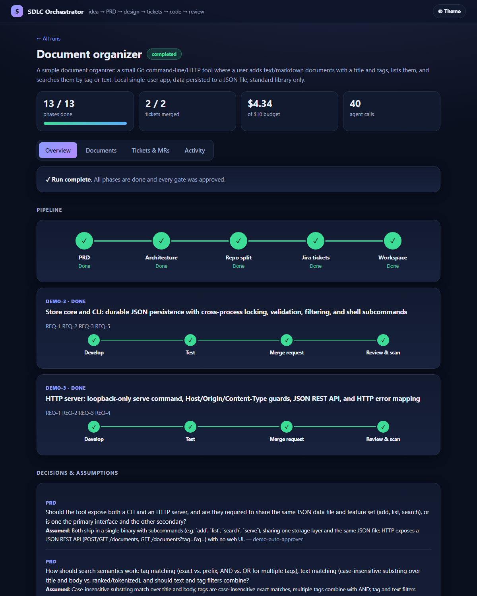
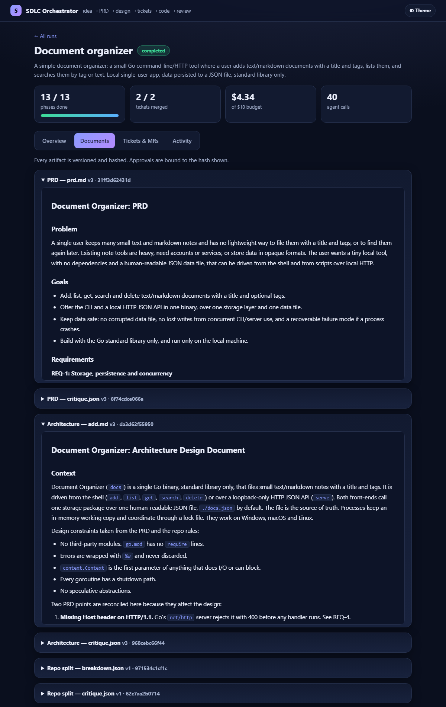
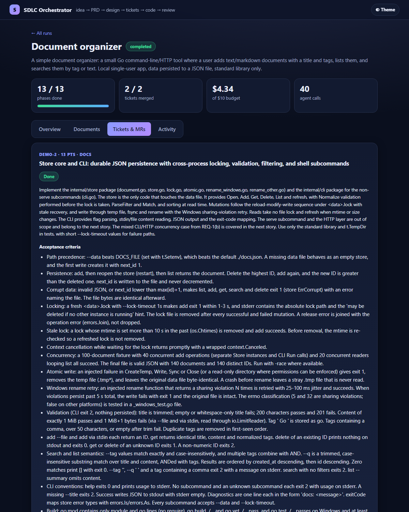
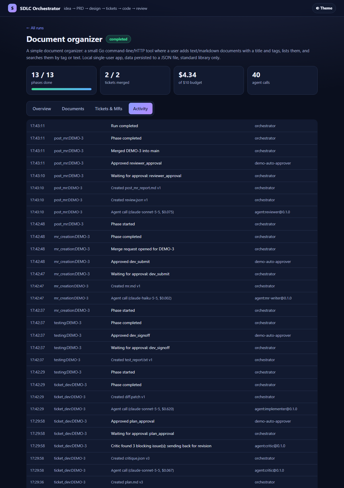

# SDLC Automator

**Turns a one-paragraph idea into reviewed, merged code, with Claude agents doing the work and people
making every decision that matters.**

You describe what you want built. The automator walks it through the whole software lifecycle: PRD,
architecture design, repo split, Jira tickets, a working repo, implementation, tests, a pull request, and a
review-and-security pass. At each stage Claude agents draft the work, a second agent attacks it, and a
person approves it before anything moves on. Every decision, document version and approval is recorded, so you
can trace any line of code back to the requirement that asked for it.

It is not "one giant prompt". It is a **deterministic Go orchestrator** (a Postgres-backed state machine, no
LLM in control flow) that calls Claude agents inside bounded, validated steps.

---

## What happens when you start a run

```
 idea ──► PRD ──► Architecture ──► Repo split ──► Jira tickets ──► Workspace
          │          │               │              │ (dry-run        │ (repo created,
          │          │               │              │  preview)       │  scaffold pushed)
          ▼          ▼               ▼              ▼                 ▼
       every phase = clarify → generate → critique → validate → human gate → publish

 then, for each ticket, one after another:
   Plan ──► [you approve the plan] ──► Implement (TDD) ──► Test ──► Open PR ──► Review + scans
                                                                                   │
                         you merge the PR on GitHub ◄──────────────────────────────┘
                         → Jira moves to Done, next ticket branches from the new main
```

The same six-step loop runs inside **every** phase:

| Step | Who | What happens |
|---|---|---|
| **Clarify** | Agent, then you | The agent lists what is ambiguous as numbered questions, each with a proposed default. The phase **cannot proceed** until every question is answered, or you explicitly accept the default as a recorded assumption. |
| **Generate** | Agent / tools | Produces the artifact (PRD, design, tickets, plan, code...) as an immutable, hashed, versioned document. |
| **Critique** | A *separate* agent | Attacks the draft (untestable requirements, missing failure modes, contradictions with upstream docs). Blocking findings send it back for revision, a bounded number of times. |
| **Validate** | Plain code, no LLM | Hard checks: every requirement is addressed in the design, every requirement is covered by a ticket, tests pass, and so on. |
| **Gate** | **You** | You see the document, the critic's findings and how many revision rounds it took, then approve or request changes. Your approval is bound to that exact document version (by content hash). |
| **Publish** | Orchestrator | The side effects: a Confluence page, Jira issues, a git branch, a pull request. |

### The nine phases

| # | Phase | What the agents do | What you decide |
|---|---|---|---|
| 1 | **PRD** | Ask clarifying questions, write the PRD with numbered, testable requirements | Answer questions; approve the PRD |
| 2 | **Architecture (ADD)** | Design every requirement: components, data model, failure modes, test strategy | Approve the design |
| 3 | **Repo split** | Decide which repos the work belongs in | Approve |
| 4 | **Jira tickets** | Write an epic and stories with acceptance criteria, covering every requirement | Approve a **dry-run preview**; nothing is created in Jira until you do |
| 5 | **Workspace** | (Automatic) create the GitHub repo, scaffold it, smoke-check the build | none |
| 6 | **Develop** (per ticket) | Propose an implementation plan, then implement it test-first in an isolated git worktree | Approve the **plan before any code is written** |
| 7 | **Test** | Run vet and the test suite; if they fail, an agent fixes and re-runs | Sign off on results |
| 8 | **Merge request** | Write the PR description with the Jira link, requirement trace and test evidence; push the branch and open the PR | Approve submission |
| 9 | **Review and scan** | A review bot checks the diff against the repo's rules; scanners run (go vet, gosec, govulncheck, gitleaks if installed); blocking findings are fixed and re-reviewed | Approve; then **you merge the PR** |

## What it guarantees

- **Humans stay in control.** Nothing irreversible happens without an approval, and the plan is approved before
  code exists.
- **No silent guessing.** Ambiguity is surfaced as a ledger of questions. Accepted assumptions are written into
  the document, not buried.
- **Approvals can't go stale.** A database trigger rejects an approval whose content hash doesn't match the
  document under review.
- **Agents check each other.** The critic is a separate agent from the writer; deterministic validators check
  both.
- **Full traceability.** `sdlc trace` shows requirement → design section → Jira story → commit → PR → merge.
- **Complete audit trail.** Every question, answer, artifact version, approval and agent call (model, tokens,
  cost) is stored and streamed as events.
- **Cost control.** A per-run budget is enforced; models are routed by task (strong for design and review,
  cheaper for formatting).
- **Safe to retry.** Jobs use leases and retries; Jira issue creation is idempotent so a retry never duplicates
  tickets; credentials are redacted from error messages.
- **A merge gate you can wire into CI.** `sdlc ci-check <run-id>` exits non-zero if a PR doesn't belong to a run
  with all required phases and approvals complete.

## Quick start

```
go build -o sdlc.exe ./cmd/sdlc

# Unattended demo (an auto-approver stands in for people and is labelled as such in the audit trail)
sdlc demo -agent mock              # deterministic and free, ~20 seconds
sdlc demo -agent claude -budget 10 # real Claude agents build the sample "document organizer"

# Human-in-the-loop
sdlc up -agent claude              # embedded Postgres + workers + dashboard on :8080
# open http://localhost:8080, start a run, answer questions, approve gates
# (or use the CLI: start / status / answer / approve / trace / ci-check / retry)
```

Postgres is embedded (port 5433, data in `data/pg`), so no Docker is needed; set `SDLC_DB` to use your own.

### Connect real Jira, Confluence and GitHub (optional)

Copy `sdlc.env.example` to `sdlc.env` (git-ignored), fill it in, and run `sdlc check-integrations`. It only
reads; it creates nothing. Leave a block out and that part stays local.

| Integration | When you approve... | It does |
|---|---|---|
| **Confluence** | the PRD and the ADD | Publishes each as a page in your space |
| **Jira** | the dry-run preview | Creates a real epic and stories (parent-linked, labelled `sdlc-<run>`); moves each story In Progress → In Review → Done as work advances |
| **GitHub** | the workspace, then each MR | Creates the repo, pushes branches, opens a PR with the run id in its description, then **waits for you to merge it** and continues on its own |

Use a sandbox Jira project, Confluence space and GitHub owner for first runs, and run with `-agent mock` to
test the wiring cheaply.

## Screenshots

A full run captured from the dashboard, one screen per capability. **Provenance:** these were captured with
the deterministic `mock` agent (so spend shows $0.00 and the PRD text is short and canned) against the
fake Jira/Confluence/GitHub server (`cmd/fakeapi`) backed by real git repos. Humans are simulated by
driving the dashboard's own forms (`scripts/capture-screenshots.ps1`); the approver names in the audit trail
(`priya-pm`, `arjun-lead`, `sam-dev`, `mei-reviewer`) are placeholders. Everything on screen is the real
orchestrator, state machine, UI and integration code.

### 1. Start a run
Describe what to build; pick a change size (trivial changes skip PRD + design).


### 2. Ambiguity ledger: agents ask, you decide
Before each phase the agent raises prioritized questions with a proposed default. The phase will not proceed
until each is answered, or the default is explicitly accepted as an assumption (which is recorded and written into the document).


### 3. Approval gates, bound to the exact document version
Every gate shows the document under review (rendered), the critic agent's findings and how many revision
rounds it forced, and records who approved which content hash.

| PRD approval | Jira dry-run preview |
|---|---|
|  |  |

| Implementation plan (before any code) | Post-MR review and scan results |
|---|---|
|  |  |

### 4. Real integrations: the pipeline waits for a human to merge the GitHub PR
Links to the published Confluence pages and GitHub repo appear on the run; after review approval the
pipeline polls the PR and continues by itself once it is merged.


### 5. Run complete: pipeline, per-ticket progress, decisions and assumptions


### 6. Documents (versioned, hashed), tickets and merge requests

| Documents | Tickets and MRs |
|---|---|
|  |  |

### 7. Audit trail, runs list and light theme

| Activity feed | Runs list |
|---|---|
|  |  |


### CLI

`sdlc status`, `sdlc trace` (requirement to merge) and `sdlc ci-check` for the same run are in
[`docs/cli-output.txt`](docs/cli-output.txt).

To regenerate: start `fakeapi`, start `sdlc up -agent mock` (no auto-approve) and run
`pwsh scripts/capture-screenshots.ps1 -Base http://localhost:8090`.

## A real run with Claude agents

The screenshots above use the mock agent. This section is the same orchestrator driving **real Claude
agents** (`sdlc demo -agent claude`) to build the sample app end to end: **13/13 phases, 2 tickets merged,
40 agent calls, $4.34 against a $10 budget, in under an hour.**

Honest notes: the clarifying questions and gates in this run were resolved by the demo auto-approver
(`demo-auto-approver` in the audit trail), not by people, and Jira/GitHub were the local stand-ins. What
is real is every agent-written artifact and every line of code below.

| Overview: pipeline, tickets, decisions | Documents: Claude-written PRD and ADD |
|---|---|
|  |  |

| Tickets and MRs | Activity |
|---|---|
|  |  |

- The artifacts: [`docs/real-claude-run/prd.md`](docs/real-claude-run/prd.md) (125 lines) and
  [`docs/real-claude-run/add.md`](docs/real-claude-run/add.md) (249 lines). Each went through critic loops before approval.
- The app it built, as committed by the pipeline:
  [`examples/document-organizer-built-by-pipeline/`](examples/document-organizer-built-by-pipeline)
  (store with atomic writes and cross-process locking, CLI, loopback HTTP API with Host/Origin guards; `go vet` and
  all tests pass standalone).
- A transcript of using it: [`docs/real-claude-run/app-demo.txt`](docs/real-claude-run/app-demo.txt)
  (add, list, search by tag/text, validation, HTTP API, 403 on a foreign Host header).
- CLI view of the run, including the requirement-to-merge trace: [`docs/real-claude-run/cli-output.txt`](docs/real-claude-run/cli-output.txt).

## How it is built

```
cmd/sdlc          CLI + dashboard server + worker entrypoint
cmd/fakeapi       fake Jira/Confluence/GitHub server (real bare git repos) for testing the integrations
internal/engine   the orchestrator: phase definitions, state machine, queue, gates, ledger, views
internal/agent    Claude Code headless runner, deterministic mock runner
internal/integrations   Jira, Confluence, GitHub REST clients
internal/web      dashboard (dark/light), approvals, ledger, documents, activity
migrations/       Postgres schema (runs, phases, artifacts, ledger, gates, approvals, jobs, events, traces)
phases/ events/   phase contract example and event schema
scripts/          screenshot capture driver
docs/ examples/   screenshots, real-run evidence, the app the pipeline built
```

- **State machine:** `internal/engine/worker.go` implements the six-step loop once; `phases.go` defines what is
  specific to each phase. Work is claimed from a Postgres queue with `SKIP LOCKED` leases; events go through a
  transactional outbox (written to `data/events.jsonl`; swap in a Kafka producer in `FlushOutbox`).
- **Agents:** `claude` drives Claude Code headless (`claude -p`) with per-call cost capture and a hard per-run
  budget; `mock` is deterministic and deliberately triggers the critique and review-fix loops so the control flow
  can be tested for free.
- **Phase tools:** planners and reviewers get read-only repo access; implementers work in an isolated git worktree
  with a restricted tool allow-list and don't run git themselves (the orchestrator commits).

## Status and honest limits

**Verified**
- The full pipeline end to end with mock agents (all phases, both feedback loops) and with real Claude agents
  (13/13 phases, a working app built; see above).
- The Confluence, Jira and GitHub integrations against a fake server, and against real Atlassian and GitHub
  accounts: pages published, a real epic and stories created with parent links and labels, a repo scaffolded,
  a feature branch pushed and a PR opened, and the story moved to In Review. The final wait-for-merge, then Done
  leg has so far been exercised against the fake server.
- Running against real accounts found and fixed two bugs that the fake server hid: a git auth header (the token,
  base64-encoded) leaking into error messages, and a retry that reported success while the GitHub remote was
  still empty. Both now have tests.

**Not built yet**
- Approver identity is a free-text name: no SSO, and `required_role` is displayed but not enforced.
- No re-run of downstream phases when an approved upstream document changes (lineage is recorded; the
  invalidation logic is not).
- No overdue-gate escalation, and no Slack or Jira approval buttons (approvals happen in the dashboard or CLI).
- Testing is vet plus unit tests: no integration (testcontainers), contract or Playwright suites. Scanners
  (gosec, govulncheck, gitleaks) run only if installed.
- Tickets run one after another within a run; there is no cross-repo, contract-first ordering yet.
- `sdlc ci-check` is ready to wire into a required GitHub check, but isn't wired in yet.
- Crash recovery re-runs a step after its lease expires; steps are mostly but not strictly idempotent.
